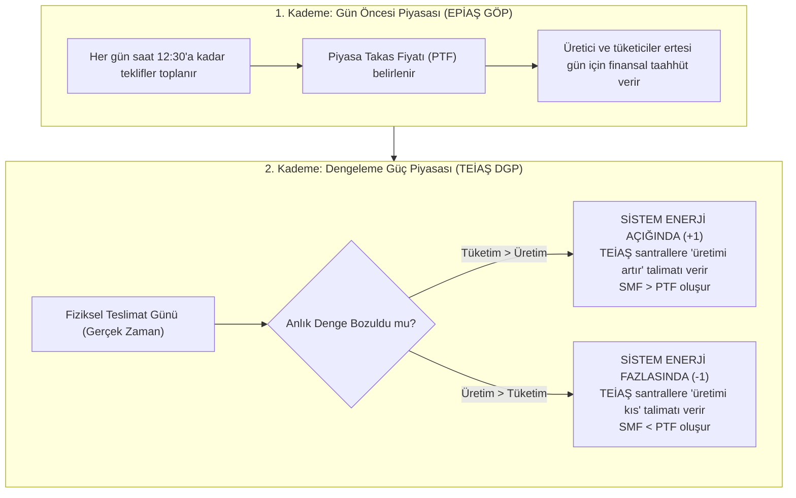

# T.C. İSTANBUL MEDENİYET ÜNİVERSİTESİ
# MÜHENDİSLİK VE DOĞA BİLİMLERİ FAKÜLTESİ
## LİSANS BİTİRME TEZİ: KAPSAMLI ÇALIŞMA VE KONU REHBERİ

**Tez Başlığı:** EPİAŞ Elektrik Piyasasında Sistem Marjinal Fiyatı (SMF) ve Sistem Denge Yönü Tahmini: Ekonometrik Doğrulama, Model Atıf Analizi ve İleriye Dönük Test Protokolü  
**Öğrenci:** Burak Ramazan Uçar  
**Tez Danışmanı:** Prof. Dr. Ali Dinler  
**Tarih:** 20 Ekim 2026  

---

## İÇİNDEKİLER

1. [Büyük Resim: Türkiye Elektrik Piyasası Nasıl Çalışır?](#1-büyük-resim-türkiye-elektrik-piyasası-nasıl-çalışır)
2. [Tezin Temel Amacı ve Çözülen Problem](#2-tezin-temel-amacı-ve-çözülen-problem)
3. [Piyasa Zaman Çizelgesi ve İki Aşamalı Karar Mimarisi](#3-piyasa-zaman-çizelgesi-ve-iki-aşamalı-karar-mimarisi)
4. [Mevzuat ve Finansal Uzlaştırma Mekanizması (EPDK Karar 14030)](#4-mevzuat-ve-finansal-uzlaştırma-mekanizması-epdk-karar-14030)
5. [Geliştirilen Makine Öğrenmesi Modelleri](#5-geliştirilen-makine-öğrenmesi-modelleri)
6. [Elde Edilen 7 Temel Bilimsel Çıkarım (Tezin Ana Mesajı)](#6-elde-edilen-7-temel-bilimsel-çıkarım-tezin-ana-mesajı)
7. [P&L Neyi Ölçüyor? Para Nereden Kazanılıyor? (Atıf Ayrıştırması)](#7-pl-neyi-ölçüyor-para-nereden-kazanılıyor-atıf-ayrıştırması)
8. [İleriye Dönük Doğrulama Protokolü (protocol-v1) Nedir?](#8-ileriye-dönük-doğrulama-protokolü-protocol-v1-nedir)
9. [Tez Savunması ve Jüri Soru-Cevap Kılavuzu](#9-tez-savunması-ve-jüri-soru-cevap-kılavuzu)

---

## 1. Büyük Resim: Türkiye Elektrik Piyasası Nasıl Çalışır?

Elektrik, depolanması son derece maliyetli ve fiziksel olarak şebeke frekansının (50 Hz) her an dengede tutulmasını zorunlu kılan benzersiz bir emtiadır. Üretim ile tüketim anlık olarak eşitlenmezse şebeke çöker (blackout).

Türkiye'de elektrik toptan ticareti iki ana kademede yürütülür:



### Temel Piyasa Kavramları Sözlüğü
- **PTF (Piyasa Takas Fiyatı):** Bir gün önceden saatlik olarak belirlenen referans elektrik toptan satış fiyatıdır.
- **SMF (Sistem Marjinal Fiyatı):** Gerçek zamanlı fiziksel teslimat anında TEİAŞ'ın şebekeyi 50 Hz'de tutmak için devreye soktuğu en pahalı son santralin elektrik fiyatıdır.
- **Yayılım (Spread - $S_t$):** Gerçekleşen SMF ile gün öncesinde belirlenen PTF arasındaki farktır ($S_t = SMF_t - PTF_t$).
- **Sistem Denge Yönü ($D_t$):**
  - **Enerji Açığı ($+1$):** Şebekede talep arzdan fazladır. TEİAŞ yukarı dengeleme talimatı verir; genellikle $SMF \ge PTF$ olur.
  - **Enerji Fazlası ($-1$):** Şebekede arz talepten fazladır. TEİAŞ aşağı dengeleme talimatı verir; genellikle $SMF \le PTF$ olur.
  - **Dengede ($0$):** Talimat verilmez; $SMF = PTF$ olur.

---

## 2. Tezin Temel Amacı ve Çözülen Problem

Bir elektrik üreticisi (örneğin bir rüzgar veya güneş santrali), gün öncesinde sisteme ne kadar elektrik satacağını taahhüt eder. Ancak rüzgar esmezse veya santral arızalanırsa üretici **dengesizliğe (imbalance)** düşer.

Dengesizliğe düşen piyasa katılımcısı, TEİAŞ'a ceza ödemek zorunda kalır. Eğer katılımcı:
1. **Sistemin yönünü ($D_t$)** ve
2. **SMF ile PTF arasındaki yayılımı ($SMF - PTF$)**  
önceden tahmin edebilirse; portföyünü bilinçli olarak hafif açıkta veya hafif fazlada bırakarak (dengesizlik arbitrajı / hedging) cezalardan kaçınabilir ve kâr elde edebilir.

### Tezin Bilimsel Sorusu:
> *"Gelişmiş makine öğrenmesi modelleri (LightGBM, lojistik kalibrasyon), elektrik piyasasında sistem yönünü ve SMF'yi tahmin ederek piyasanın en basit kuralı olan 'Her Zaman Açık' stratejisine karşı istatistiki olarak anlamlı bir **ekonomik üstünlük (alfa)** sağlayabilir mi?"*

---

## 3. Piyasa Zaman Çizelgesi ve İki Aşamalı Karar Mimarisi

Elektrik piyasasında zaman kısıtları son derece katıdır. Modeller geriye dönük veri sızıntısını (lookahead bias) engellemek adına iki ayrı karar anına göre tasarlanmıştır:

```
[D-1 Günü (Teslimattan 1 Gün Önce)]                         [D Günü (Fiziksel Teslimat)]
 Saat 11:30                  Saat 12:30    Saat 14:00        Saat 00:00 ---------- 23:00
      |                           |             |                 |                      |
      v                           v             v                 v                      v
[AŞAMA 1 KARAR ANI]        [GÖP Kapanışı] [AŞAMA 2 KARAR ANI] [24 Saatlik Teslimat Dönemi]
 • PTF HENÜZ BİLİNMİYOR      • Teklifler   • PTF ARTIK BİLİNİYOR  • SMF ve Denge Yönü
 • Tahmin Ufku: 12-36 saat     Kilitlenir  • Tahmin Ufku: 10-34h    fiziksel olarak oluşur
 • Hedef: 3 Sınıflı Yön                    • Hedef: Yayılım (SMF-PTF)
```

1. **Aşama 1 (GÖP Öncesi — Saat 11:30):**  
   Henüz $PTF$ açıklanmamıştır. Model yalnızca tarihsel fiyatları, TEİAŞ'ın gün öncesi rüzgar üretim tahminini (`wind_forecast`) ve yük tahminini (`load_forecast`) bilmektedir. 3 sınıflı bir yön sınıflandırıcısı çalıştırılır.
2. **Aşama 2 (GÖP Sonrası — Saat 14:00):**  
   Saat 14:00 itibarıyla ertesi günün 24 saatinin kesinleşmiş $PTF$ fiyatı açıklanmıştır. Bu bilgi modele katılarak $SMF - PTF$ yayılımı regresyon ile tahmin edilir.

---

## 4. Mevzuat ve Finansal Uzlaştırma Mekanizması (EPDK Karar 14030)

Piyasa katılımcılarının nakit akışını EPDK'nın yayımladığı **Dengesizlik Fiyatlandırma Formülü** belirler.

Sistemde iki farklı ceza katsayısı vardır:
- $k$: Negatif dengesizlik (enerji açığı) ceza katsayısı
- $l$: Pozitif dengesizlik (enerji fazlası) indirim katsayısı

*(Dönemsel katsayılar: 2025 yılında $k=0,03, l=0,03$; 2026 yılında ise $k=0,06, l=0,06$ olarak uygulanmıştır).*

### Uzlaştırma Fiyatları Formülü:
- **Negatif Dengesizlik Fiyatı ($P_{\text{neg}}$):** Enerji açığı veren katılımcının TEİAŞ'tan elektrik satın aldığı cezalı fiyattır:
  $$P_{\text{neg}} = \max(PTF, SMF) \times (1 + k)$$
- **Pozitif Dengesizlik Fiyatı ($P_{\text{pos}}$):** Enerji fazlası veren katılımcının TEİAŞ'a elektrik sattığı indirimli fiyattır:
  $$P_{\text{pos}} = \min(PTF, SMF) \times (1 - l)$$

### 2x2 Portföy Getiri (P&L) Matrisi:
Katılımcı saat $t$'de Uzun ($a_t = +1$, sisteme fazla enerji verme) veya Kısa ($a_t = -1$) pozisyon aldığında net birim kâr/zararı:

| Alınan Pozisyon ($a_t$) | Sistem Enerji Açığında ($D_t = +1$) | Sistem Enerji Fazlasında ($D_t = -1$) |
| :--- | :---: | :---: |
| **Uzun Pozisyon ($a_t = +1$)** | $+(P_{\text{neg}} - PTF)$ *(Ceza tasarrufu / Kâr)* | $-(PTF - P_{\text{pos}})$ *(İndirim kaybı / Zarar)* |
| **Kısa Pozisyon ($a_t = -1$)** | $-(P_{\text{neg}} - PTF)$ *(Ceza yükümlülüğü / Zarar)* | $+(PTF - P_{\text{pos}})$ *(Satış kazancı / Kâr)* |
| **Pasif Kalmak ($a_t = 0$)** | $0,00$ TL | $0,00$ TL |

---

## 5. Geliştirilen Makine Öğrenmesi Modelleri

Tez kapsamında disk üzerinde eğitilerek dondurulan 3 temel kanonik model geliştirilmiştir:

1. **Aşama 1 Yön Sınıflandırıcısı (`canonical_stage1_classifier.pkl`):**  
   LightGBM tabanlı 3 sınıflı yön modeli (100 ağaç, derinlik sınırsız). Sistemin Açık, Fazla veya Dengede olma olasılıklarını ($p_{\text{def}}, p_{\text{sur}}, p_{\text{bal}}$) hesaplar.
2. **Aşama 1 Platt Kalibratörü (`canonical_stage1_calibrator.pkl`):**  
   Ham model olasılıkları aşırı özgüvenli olduğundan, doğrulama kümesinde lojistik regresyon ile olasılıklar gerçek sıklıklara kalibre edilmiştir. Karar anında **marjinal beklenen değer kuralı ($\tau = 70$ TL)** ile beklenen getiri eşiği aşılırsa pozisyon alınır.
3. **Aşama 2 Yayılım Regresörü (`canonical_stage2_regressor.pkl`):**  
   PTF bilgisi dahil edildikten sonra yayılımı ($S = SMF - PTF$) tahmin eden LightGBM regresyon modeli (250 ağaç, derinlik=5, öğrenme oranı=0,03). Tahmin edilen yayılım pozitifse Uzun ($\hat{S} > 0 \rightarrow +1$), negatifse Kısa ($-1$) pozisyon açılır.

---

## 6. Elde Edilen 7 Temel Bilimsel Çıkarım (Tezin Ana Mesajı)

12 aylık (8.760 saatlik) test kümesi üzerinde yapılan deneyler ve ekonometrik testler şu 7 çarpıcı gerçeği kanıtlamıştır:

### 1. PTF, SMF'nin Baskın Bilgi Çapasıdır ($L_1$ vs $L_2$ Farkı)
Test yılında saatlerin **%21,14'ünde (1.852 saat)** $PTF = SMF$ gerçekleşmiş olup medyan yayılım tam sıfırdır.  
Bu nedenle hiçbir model kullanmayan naif **$SMF = PTF$ kuralı**, mutlak hata kaybında ($L_1$ / MAE) tüm yapay zekâ modellerini geride bırakır (**682,75 TL vs 748,14 TL**). Modelin karesel hatadaki ($L_2$ / RMSE) 12,48 TL'lik görünür üstünlüğü ise Harvey-Leybourne-Newbold (HLN) testine göre **istatistiki olarak anlamsızdır ($p = 0,2702$)**.

### 2. Yönsel Sınıflandırma Becerisi Anlamlı Fakat Çok Sınırlıdır
Aşama 1 modeli sistem yönünü **%59,66** doğrulukla tahmin ederek çoğunluk sınıfına (%55,74) göre **+3,92 puanlık** mütevazı bir üstünlük sağlamıştır ($p_{\text{adj}} \approx 0,034$). Ancak bu başarı yalnızca sabah ve gündüz saatlerindedir; akşam zirvesinde model piyasa çoğunluğunun gerisinde kalmaktadır.

### 3. P&L Yön Doğruluğuna Değil, Spread Büyüklüğüne Bağlıdır!
Yön doğruluğu yüksek olan sınıflandırıcı modeller elektrik piyasasında para kaybettirmektedir!  
- Yön doğruluğu **%62,21** olan sınıflandırıcı P&L'de **-20,81 TL/MWh zarar** ederken,
- Yön doğruluğu yalnızca **%41,70** olan $L_2$ regresörü **+119,14 TL/MWh kâr** etmektedir.  
Çünkü elektrik piyasasında kâr, yönün kaç kez doğru bilindiğine değil; sıçrama saatlerindeki **yayılımın (spread) büyüklüğüne** bağlıdır.

### 4. Ekonomik Üstünlük (Alfa) Gösterilememiştir!
Yıllık net nakit akışında Aşama 1 yön modeli (**67,33 TL/MWh**), hiçbir şey bilmeyen "Her Zaman Açık" naif kuralının (**71,73 TL/MWh**) altında kalmıştır. Eşleştirilmiş 7 günlük blok bootstrap güven aralığı **[-59,28; +44,81] TL** olup sıfırı kapsamakta; iki kuralın getirisi istatistiki olarak başa baş çıkmaktadır ($p > 0,75$).

### 5. Sonuçlar Tek Bir Aya (Haziran 2026) Aşırı Bağımlıdır
Her iki stratejinin yıllık toplam kârının **%60'tan fazlası tek bir aya (Haziran 2026)** yığılmıştır. Haziran ayı dışlandığında model ile naif kuralın getirisi eşitlenmekte (27,97 TL vs 26,64 TL; fark +1,32 TL), permütasyon testi tüm anlamlılığını kaybetmektedir ($p = 0,184$).

### 6. Risk Azalması Algoritmik Başarı Değil, Maruziyet Kısıtıdır
Aşama 1 modelinin portföy oynaklığını %28, maksimum çekilmeyi (MDD) %18,3 düşürmesi "akıllı bir risk filtresi" olmasından değil; saatlerin **%51,06'sında pasif kalarak piyasa maruziyetini yarı yarıya kesmesinden** kaynaklanmaktadır. Maruziyet-eşleşmiş permütasyon testinde modelin CVaR ($p_{\text{adj}} = 0,376$) ve MDD ($p_{\text{adj}} = 1,000$) başarımı rastgele seçimlerden farksız çıkmıştır.

### 7. Aşama 2'nin Kazancı Karmaşık Yapay Zekâ Değil, PTF Seviye Etkisidir
Aşama 2 modelinin ürettiği +119,14 TL'lik getiri, karmaşık bir yapay zekâ sezgisinden değil; piyasa tavanı ve tabanının dayattığı ortalamaya dönüş dinamiğinden kaynaklanır. Nitekim eğitim kümesi medyanına dayanan tek satırlık kural:
$$\text{"PTF} < 2.500 \text{ TL ise Uzun, } \ge 2.500 \text{ TL ise Kısa"}$$
tek başına **+140,57 TL/MWh** getiri üretmekte ve LightGBM modelini geride bırakmaktadır (aradaki fark istatistiki olarak farksızdır).

---

## 7. P&L Neyi Ölçüyor? Para Nereden Kazanılıyor? (Atıf Ayrıştırması)

Tezin en özgün ekonometrik katkılarından biri **Tablo 4D P&L Dekompozisyonudur**:

$$\text{Net P\&L} = \underbrace{a_t \cdot (SMF_t - PTF_t)}_{\text{1. Saf Yayılım (Spread)}} + \underbrace{\text{Marj}_t(k,l) + \text{Uyumsuzluk}_t}_{\text{2. Ceza Marjı + Etiket/İşaret Uyumsuzluğu}} + \underbrace{\text{Sapma}_t}_{\text{3. Platform Veri Kalıntısı}}$$

```
[KAZANÇ MEKANİZMASI AYRIŞTIRMASI]

1. Aşama 2 Modeli (+119,14 TL):
   [████████████████████████████████████████] +150,50 TL (Saf Yayılım / Spread)
   [████] -16,94 TL (Marj/Uyumsuzluk Kaybı)
   [███] -14,42 TL (Platform Sapması)
   -> Sonuç: Model YALNIZCA FİYAT YAYILIMINDAN kazanır.

2. Her Zaman Açık Naif Kuralı (+71,73 TL):
   [████] +11,86 TL (Yayılım Katkısı - Yalnızca %16,5)
   [████████████████████████] +68,47 TL (Asimetrik k=0,06 Ceza Marjı Hasılatı)
   [██] -8,60 TL (Platform Sapması)
   -> Sonuç: Naif kural piyasayı tahmin etmez; piyasadaki k=0,06 CEZA ASİMETRİSİNİ süzer!
```

---

## 8. İleriye Dönük Doğrulama Protokolü (protocol-v1) Nedir?

Akademik makine öğrenmesi çalışmalarında en sık yapılan hata, geçmiş veride en yüksek skoru veren modeli seçip geriye dönük başarı iddia etmektir (**p-hacking / data snooping**).

Bu kuşkuyu tamamen ortadan kaldırmak için tıp ve klinik deneylerdeki gibi bir **Kayıtlı Rapor (Registered Report / Pre-Analysis Plan)** protokolü kurgulanmıştır:

1. Modeller 20 Ekim 2026 itibarıyla eğitilmiş ve `.pkl` dosyaları diskte dondurulmuştur.
2. Tüm dosyaların SHA-256 kriptografik parmak izleri `MANIFEST_SHA256.txt` dosyasına mühürlenmiştir.
3. Danışmana e-posta gönderilerek **harici zaman damgası (external timestamp)** alınmıştır.
4. **Değerlendirme Penceresi:** 21 Ekim 2026 00:00 – 31 Mart 2027 23:00 (**162 Gün / 3.888 Saat**).
5. Bu süre zarfında modellerin tek bir parametresi dahi değiştirilmeyecektir. 162 gün bittiğinde veriler tek seferde indirilerek birincil hipotez (işaret-çevirme permütasyon testi) tarafsızca sınanacaktır.

---

## 9. Tez Savunması ve Jüri Soru-Cevap Kılavuzu

Jüri veya danışmanınız tezinizi incelerken aşağıdaki soruları yöneltebilir. Kararlı, net ve savunulabilir yanıtlar:

### Soru 1: "Yapay zekâ modelin yönü %59,66 ile çoğunluk sınıfından (%55,74) daha iyi tahmin etmiş, neden kârda naif kuralı geçemedi?"
**Cevap:**  
*"Hocam, elektrik piyasasında portföy getirisi yön tahmininin sayısına değil, yayılımın ($SMF - PTF$) büyüklüğüne bağlıdır. Model yön doğruluğunu sabah ve gündüz gibi yayılımın dar olduğu normal saatlerde üretirken; naif kural sistemin açıkta olduğu saatlerde mevzuatın tanıdığı $k=\%6$ ceza marjını tahsil etmektedir. Yön doğruluğundaki +3,92 puanlık artış, bu ceza marjı asimetrisini telafi etmeye yetmemektedir."*

### Soru 2: "Aşama 2 modelin +119,14 TL kâr etmiş, bu harika bir algoritma başarısı değil mi?"
**Cevap:**  
*"Görünürde öyle görünse de atıf analizimiz (Tablo 4C) bunun algoritmik bir başarı olmadığını ortaya koydu. Fiyat sınırlarının yarattığı ortalamaya dönüş dinamiği nedeniyle, yalnızca eğitim medyanına bakan deterministik 'PTF < 2.500 TL ise Uzun kal' kuralı dahi tek başına +140,57 TL kazandırmaktadır. Model karmaşık bir piyasa dinamiği öğrenmemiş; sadece PTF seviyesinin ortalamaya dönüş kuralını mekanik olarak yansıtmıştır."*

### Soru 3: "Aşama 1 modelin portföy riskini (MDD ve volatiliteyi) belirgin şekilde düşürmüş, bunu bir risk filtresi olarak savunamaz mıyız?"
**Cevap:**  
*"Savunamayız hocam; çünkü yaptığımız maruziyet-eşleşmiş permütasyon testinde (Tablo 14) modelin risk başarısının rastgele zamanlamadan farksız olduğu kanıtlanmıştır (CVaR p=0,376, MDD p=1,000). Model akıllı bir risk sezgisine sahip değildir; saatlerin %51'inde pasif kalarak piyasaya maruziyetini yarıya düşürmüş, risk de maruziyetle orantılı olarak mekanik biçimde gerilemiştir."*

### Soru 4: "İleriye dönük protokolde 162 günde neden TOST eşdeğerlik testi yapmıyorsunuz?"
**Cevap:**  
*"162 günlük pencerede standart hata yaklaşık 39,1 TL seviyesindedir. Belirlediğimiz ±65 TL eşdeğerlik marjında non-inferiority veya equivalence gösterebilmek için gözlenen farkın 0,8 TL'den küçük olması gerekir; bu durum istatistiksel güç açısından pratikte ulaşılamaz bir kısıttır. I. tip hata bütçesini tüketmemek adına TOST testini 365 günlük tam yıl izlemesine bıraktık."*

### Soru 5: "Bu tezin literatüre ve sektöre asıl bilimsel katkısı nedir?"
**Cevap:**  
*"Literatürdeki çalışmalar genellikle RMSE veya yön doğruluğunun P&L'e doğrudan yansıyacağını varsayar. Bu tez; (1) Yönsel doğruluğun ekonomik avantaja dönüşmediğini, (2) P&L getirisinin saf yayılım, yasal ceza marjı ve rejim yapısı olmak üzere 3 bileşene ayrılabileceğini, (3) Seviye etkilerinin makine öğrenmesi başarısı gibi görünebileceğini ekonometrik olarak ispatlamış ve kriptografik zaman damgalı ilk tescilli protokolü kurmuştur."*

---

**Burak Ramazan Uçar**  
T.C. İstanbul Medeniyet Üniversitesi  
Lisans Bitirme Tezi Çalışması, Ekim 2026
